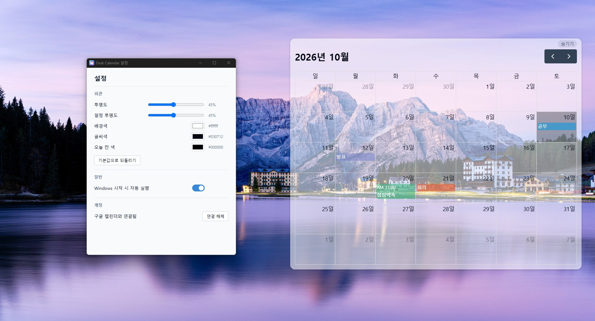
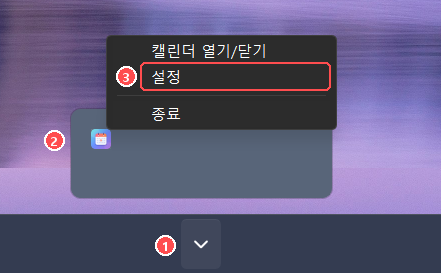

# Desk Calendar

Windows 바탕화면에 월간 캘린더를 띄우고, 바탕화면에서 바로 일정을 추가·수정·삭제하는 데스크톱 앱입니다. Google 캘린더와 연결하면 휴대폰이나 웹에서 넣은 일정이 바탕화면에 보이고, 바탕화면에서 고친 일정도 Google 캘린더에 반영됩니다.

## 기능

- 바탕화면에 붙는 반투명 월간 캘린더(이동, 크기 조절, 날짜 칸 숨기기)
- 날짜를 클릭해 일정 추가, 일정을 클릭해 수정·삭제
- 일정마다 색 지정(Google 캘린더의 일정 색 11가지와 같음)
- Google 캘린더 연결(선택). 연결하지 않으면 일정은 이 PC에만 저장됩니다.
- 트레이 아이콘, 투명도·색 설정, Windows 시작 시 자동 실행

## 설치

### 필요한 것

- Windows 10 또는 11(64비트)
- Google 캘린더와 연결하려면 Google 계정과 인터넷 연결

그 밖에 따로 설치할 것은 없습니다. 화면을 그리는 Microsoft Edge WebView2는 Windows 11과 최근 Windows 10에 이미 들어 있고, 없는 PC에서는 설치 파일이 자동으로 내려받습니다(이때 인터넷이 필요합니다).

### 설치 순서

1. [Releases](https://github.com/rkdworn/desk-calendar/releases) 페이지에서 최신 버전의 `Desk Calendar_<버전>_x64-setup.exe`를 내려받습니다.
2. 내려받은 파일을 실행합니다.
3. 파란색 **"Windows의 PC 보호"** 창이 뜨면 **추가 정보 → 실행**을 누릅니다.
   코드 서명 인증서가 없는 개인 프로젝트라서 나오는 경고입니다.
4. 설치 화면을 따라 설치합니다. 관리자 권한은 필요 없습니다(내 Windows 계정에만 설치됩니다).

설치를 마치고 실행하면(나중에는 시작 메뉴의 **Desk Calendar**) 바탕화면 오른쪽 위에 캘린더가 나타나고, 작업 표시줄 오른쪽 알림 영역에 달력 모양의 트레이 아이콘이 생깁니다.

## 설정 여는 방법

투명도와 색, 자동 실행, Google 계정 연결은 설정 창에서 합니다. 설정 창은 트레이 아이콘에서 엽니다.

1. 작업 표시줄 오른쪽의 **^**(숨겨진 아이콘 표시)를 누릅니다. 아이콘이 작업 표시줄에 바로 보이면 이 단계는 건너뜁니다.
2. 달력 모양의 **Desk Calendar 아이콘**을 **오른쪽 클릭**합니다. 왼쪽 클릭은 캘린더 열기/닫기입니다.
3. 메뉴에서 **설정**을 누릅니다.

트레이 아이콘을 작업 표시줄에 항상 보이게 하려면 Windows **설정 → 개인 설정 → 작업 표시줄 → 기타 시스템 트레이 아이콘**에서 Desk Calendar를 켜세요.

## Google 캘린더 연결

1. [설정 창](#설정-여는-방법)을 열고 계정의 **구글 계정 연결**을 누릅니다.
2. 브라우저에 Google 로그인 화면이 열리면 사용할 계정을 고릅니다.
3. **"Google에서 확인하지 않은 앱"** 화면이 나오면 **고급 → Desk Calendar(으)로 이동**을 누릅니다.
   아직 Google 심사를 받지 않은 개인 프로젝트라서 나오는 경고입니다.
4. 권한 화면에서 **캘린더 일정 보기·수정 항목에 체크**하고 **계속**을 누릅니다. 체크를 빼면 연결되지 않습니다.
5. 브라우저에 연결 완료 문구가 나오면 탭을 닫습니다. 설정 창에 "구글 캘린더와 연결됨"이 표시되고 바탕화면에 Google 일정이 나타납니다.

한 번 연결하면 PC를 다시 켜도 연결이 유지됩니다.

- 바탕화면에는 Google 계정의 기본 캘린더(내 이름으로 된 캘린더) 일정만 보입니다.
- 바탕화면에서 추가·수정·삭제한 일정은 바로 Google 캘린더에 반영됩니다.
- 휴대폰이나 웹에서 바꾼 일정은 5분 안에 바탕화면에 나타납니다. 바로 보려면 트레이 아이콘을 두 번 눌러 캘린더를 닫았다 여세요.
- 연결 전에 이 PC에만 넣어 둔 일정은 Google로 옮겨지지 않습니다. 연결 중에는 보이지 않고, 연결을 해제하면 다시 보입니다.

## 사용법

| 하고 싶은 일 | 방법 |
|---|---|
| 일정 추가 | 날짜 칸을 클릭 → 제목·날짜 입력 → 저장 |
| 일정 수정·삭제 | 일정을 클릭 → 고친 뒤 저장, 또는 삭제 → 정말 삭제 |
| 일정 색 바꾸기 | 일정 편집 창의 "종일" 오른쪽 색 버튼. 새 일정은 무작위 색으로 시작합니다 |
| 다른 달 보기 | 오른쪽 위 ‹ › 버튼 |
| 캘린더 옮기기 | 캘린더 위에 마우스를 올리면 맨 위 가운데에 보이는 막대를 끌기 |
| 크기 바꾸기 | 캘린더 위에 마우스를 올리면 왼쪽 위·오른쪽 아래 모서리에 보이는 손잡이를 끌기 |
| 날짜 칸 숨기기 | 오른쪽 위 작은 **숨기기** 버튼(다시 누르면 **펼치기**) |
| 캘린더 닫기·열기 | 트레이 아이콘 왼쪽 클릭. 닫아도 프로그램은 트레이에 남습니다 |
| 투명도·색 바꾸기 | [설정 창](#설정-여는-방법) |
| Windows 켤 때 자동 실행 | [설정 창](#설정-여는-방법) → 일반 → Windows 시작 시 자동 실행 |
| 프로그램 완전히 끄기 | 트레이 아이콘 오른쪽 클릭 → 종료 |

반복 일정은 날짜별로 따로 보입니다. 바탕화면에서 반복 일정 하나를 고치거나 지우면 그 날짜의 일정만 바뀝니다.

## 업데이트

새 버전의 설치 파일을 내려받아 그대로 설치하면 됩니다. 일정, 설정, Google 연결은 그대로 유지됩니다.

## 삭제

1. 먼저 설정에서 **연결 해제**를 누릅니다. 그래야 PC에 저장된 Google 로그인 정보까지 지워집니다.
2. Windows **설정 → 앱 → 설치된 앱**에서 **Desk Calendar**를 찾아 **제거**합니다.

Google 캘린더의 일정은 Google 계정에 그대로 남습니다.

## 알아 둘 점

- 캘린더는 바탕화면 아이콘보다 위에 그려지므로, 캘린더 밑에 있는 아이콘은 반투명 판 너머로 흐리게 보이기만 하고 클릭할 수 없습니다. 위치와 크기를 조절해 비어 있는 곳에 두세요.
- Windows 업데이트 등으로 탐색기가 다시 시작되면 캘린더가 사라질 수 있습니다. 프로그램은 트레이에 남아 있으니 트레이 아이콘을 눌러 다시 여세요.
- 화면 배율이 다른 모니터로 옮기면 글자나 크기가 어색하게 보일 수 있습니다.

## 개인정보

앱에는 서버가 없고, 일정은 사용자 PC와 Google 사이에서만 오갑니다. 개발자는 사용자의 일정이나 계정 정보를 받지 않습니다. 자세한 내용은 [개인정보처리방침](PRIVACY.md)을 보세요.

문제가 있거나 제안할 것이 있으면 [GitHub 이슈](https://github.com/rkdworn/desk-calendar/issues)로 남겨 주세요.

## 개발

React + TypeScript + Vite + FullCalendar 웹 화면을 Tauri 2로 감싼 Windows 앱입니다. 개발 환경과 구조는 [CLAUDE.md](CLAUDE.md)에 정리되어 있습니다.
